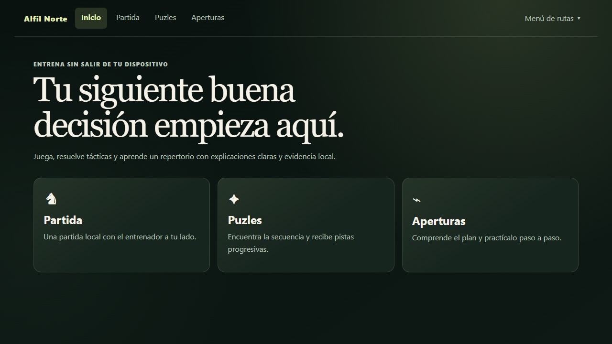
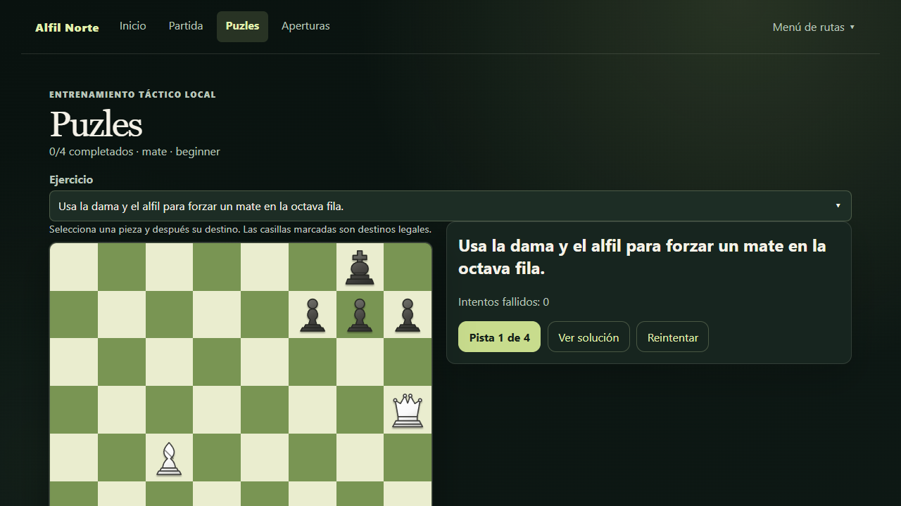
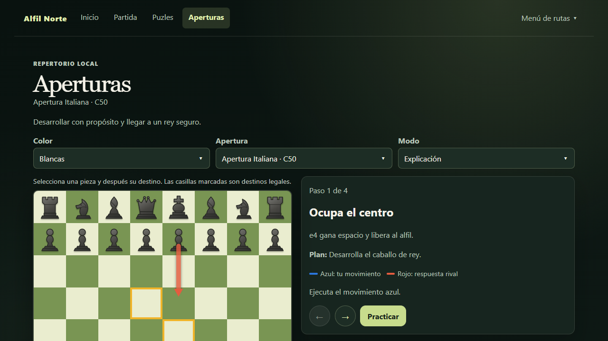

# Alfil Norte

Entrenador de ajedrez offline-first para jugar, analizar y recibir feedback determinista sin depender de un LLM. El producto combina un rival local de estilo humano para escritorio, analisis local con Stockfish y una PWA instalable para practica diaria.

[Demo estatica en GitHub Pages](https://pablobeas.github.io/chess-coach-play/) |
[Arquitectura](docs/ARCHITECTURE.md) |
[Calidad](docs/QUALITY.md) |
[Seguridad](SECURITY.md) |
[Contribucion](CONTRIBUTING.md) |
[Terceros y source](docs/THIRD_PARTY.md) |
[Stockfish source](docs/STOCKFISH_SOURCE.md)

## Capturas

<table>
  <tr>
    <td align="center">
      
      <br />
      <sub>Inicio</sub>
    </td>
    <td align="center">
      
      <br />
      <sub>Puzles</sub>
    </td>
    <td align="center">
      
      <br />
      <sub>Aperturas</sub>
    </td>
  </tr>
</table>

## Que hace hoy

- Juega partidas completas en local.
- Explica cada decision del usuario con evidencia del motor y reglas deterministas.
- Funciona como PWA instalable y mantiene la partida en el dispositivo.
- Exporta e importa PGN con limites defensivos.
- Ofrece puzles y practica de aperturas sin depender de servicios remotos.

## Inicio rapido

Requisitos:

- Node.js `>=22 <25`
- pnpm `11.x`
- Python `3.10-3.12`
- Git

Instalacion y arranque:

```powershell
pnpm install
pnpm dev
```

Atajo en Windows:

```powershell
.\play.ps1
```

Comprobaciones principales:

```powershell
pnpm typecheck
pnpm test
pnpm build
pnpm check
pnpm format:check
```

## Demo publica frente a modo local

La demo estatica publicada en GitHub Pages sirve para validar la experiencia PWA y el flujo offline del navegador. No intenta exponer Maia-3 en remoto.

| Entorno | Rival | Analisis | Red necesaria |
| --- | --- | --- | --- |
| GitHub Pages | Stockfish local en navegador | Stockfish local en navegador | Solo para cargar la app y assets la primera vez |
| `pnpm dev` / `play.ps1` | Maia-3 local por loopback, con fallback local | Stockfish local | La primera preparacion de Maia puede requerir red |

La limitacion es intencionada: Maia-3 se ejecuta como companion local sobre `127.0.0.1` y no se publica como backend remoto del producto.

## Maia-3 y Stockfish

El proyecto separa dos responsabilidades:

- **Stockfish local** es la fuente de verdad para evaluacion y feedback.
- **Maia-3 5M local** actua como rival de estilo humano en escritorio/desarrollo local.

En el primer arranque con Maia, `tools/setup-maia3.ps1`:

1. crea `.runtime/maia3`;
2. instala Maia desde un commit fijado;
3. verifica el hash del checkpoint oficial;
4. guarda evidencia local en `install-report.json` y `resolved-packages.json`.

Limitacion honesta: el commit de Maia y el hash del checkpoint estan fijados, pero sus dependencias transitivas de Python siguen resolviendose desde upstream durante la instalacion inicial. El repo registra esa resolucion localmente para auditoria, pero no redistribuye un entorno vendorizado ni afirma un lockfile cerrado para todo el arbol transitivo.

## Arquitectura del monorepo

- `apps/web`: React/Vite, PWA y experiencia de usuario.
- `packages/chess-core`: reglas, FEN, PGN y tipos de dominio.
- `packages/engine`: contrato UCI y ejecucion del motor en Worker.
- `packages/coach`: evaluacion pedagogica, pistas y mensajes estructurados.
- `tests/evals`: posiciones y partidas de referencia.
- `docs`: producto, arquitectura, calidad, decisiones, seguridad y terceros.

Dependencias permitidas:

- `web -> coach -> engine`
- `web -> chess-core`
- `coach -> chess-core`
- `engine -> chess-core`

## Seguridad, licencia y codigo fuente

- Licencia del proyecto: [GPL-3.0-or-later](LICENSE).
- Avisos de terceros y procedencia de artefactos: [docs/THIRD_PARTY.md](docs/THIRD_PARTY.md).
- Fuente correspondiente y hashes de Stockfish redistribuido: [docs/STOCKFISH_SOURCE.md](docs/STOCKFISH_SOURCE.md).
- Politica de reporte: [SECURITY.md](SECURITY.md).
- Guía de contribucion: [CONTRIBUTING.md](CONTRIBUTING.md).
- Revision puntual del endurecimiento actual: [docs/SECURITY_REVIEW.md](docs/SECURITY_REVIEW.md).
- Threat model: [docs/proyecto-ajedrez-threat-model.md](docs/proyecto-ajedrez-threat-model.md).

El MVP no usa modelos de lenguaje para legalidad, evaluacion, tactica ni feedback. La ruta critica es local y determinista; no se envian partidas ni datos personales sin consentimiento.

## Contribucion

La guia de contribucion vive en [CONTRIBUTING.md](CONTRIBUTING.md). Si no tienes escritura directa sobre `main`, trabaja en un fork y abre un pull request; si la tienes, usa ramas pequenas y evita escribir directamente en `main`. El codigo tecnico usa ingles; los textos visibles y la documentacion de producto se mantienen en espanol por defecto.

## Autor y contacto

- Autor: [Pablo Beas](mailto:pbeasboc@gmail.com)
- Email: [pbeasboc@gmail.com](mailto:pbeasboc@gmail.com)
- LinkedIn: [https://www.linkedin.com/in/pablo-beas-bocanegra-05882a200/](https://www.linkedin.com/in/pablo-beas-bocanegra-05882a200/)
- GitHub: `@Pablobeas`
