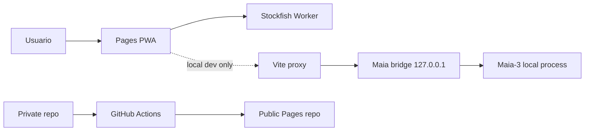

# proyecto-ajedrez threat model

## Executive summary

La superficie pública actual es pequeña: una PWA estática publicada en GitHub Pages, sin autenticación, sin backend remoto y sin envío deliberado de FEN, PGN o datos personales fuera del dispositivo. La ruta crítica del MVP sigue siendo local: Stockfish/WASM en navegador para análisis y feedback, y un bridge loopback opcional de Maia-3 solo para desarrollo local.

Los riesgos principales no están en exposición de cuentas o bases de datos, sino en cuatro frentes concretos:

1. abuso del bridge local de Maia-3 durante desarrollo;
2. fuga accidental de artefactos o secretos al espejo público de Pages;
3. entradas locales malformadas o sobredimensionadas;
4. procedencia, licencias y reproducibilidad parcial de dependencias redistribuidas o instaladas localmente.

El repositorio ya implementa controles defensivos proporcionales: validación de `Host`/`Origin`, `Content-Type` JSON, límites de cuerpo y cola `429` en el bridge local (`tools/maia3-bridge.mjs`); límites de importación PGN en UI (`apps/web/src/App.tsx`); allowlist y denylist de artefactos para publicación (`tools/publish-pages.mjs`); y documentación de hash/licencia/fuente correspondiente para Stockfish y Maia (`docs/THIRD_PARTY.md`, `docs/STOCKFISH_SOURCE.md`, `tools/setup-maia3.ps1`, `tools/maia3-manifest.json`).

Los residuales más relevantes y honestos hoy son:

- GitHub Pages obliga a degradar parte de la política de framing a meta CSP, que no puede imponer `frame-ancestors` ni `X-Frame-Options` como sí hacen los headers completos (`apps/web/public/_headers`, `tools/publish-pages.mjs`, `tools/pwa-headers.test.mjs`).
- Maia-3 fija commit y hash del checkpoint, pero no ofrece un lock portátil cerrado para dependencias transitivas de Python y la licencia de los pesos sigue abierta (`tools/maia3-manifest.json`, `tools/setup-maia3.ps1`, `docs/THIRD_PARTY.md`).

## Scope and assumptions

En alcance:

- `apps/web` como artefacto PWA estático publicado.
- `tools/publish-pages.mjs` y `.github/workflows/publish-pages.yml`.
- `tools/maia3-bridge.mjs`, `tools/dev-with-maia.mjs` y `tools/setup-maia3.ps1`.
- Controles locales de PGN/FEN/UCI y documentación de terceros/licencias.

Fuera de alcance:

- compromiso del sistema operativo del usuario;
- compromiso de la cuenta GitHub del mantenedor;
- compromisos upstream de npm, Hugging Face o el repositorio de Maia fuera de lo que el repo ya fija y verifica;
- cualquier backend futuro, autenticación futura o sincronización en red futura.

Suposiciones operativas:

- La demo pública en Pages es estática y no expone `/maia3-api` (`README.md`, `docs/ARCHITECTURE.md`).
- El bridge de Maia se usa solo en entornos locales de desarrollo sobre loopback.
- No hay telemetría ni recolección remota de partidas por defecto.
- El espejo público puede ser consultado por cualquiera y debe asumirse permanentemente archivado.

## System model/Primary components/Data flows and trust boundaries

### Primary components

- PWA React/Vite en `apps/web`.
- `chess-core` para legalidad, FEN y PGN.
- Worker local de Stockfish/WASM para análisis y fallback de rival.
- Bridge Node de Maia-3 para desarrollo local sobre `127.0.0.1`.
- Flujo de publicación privado -> artefacto estático -> repositorio público de Pages.
- Documentación y snapshot de terceros para cumplimiento/licencia.

### Data flows and trust boundaries

Límites de confianza:

- Navegador del usuario <-> artefactos estáticos servidos desde GitHub Pages.
- UI React <-> Worker local de Stockfish.
- UI local de desarrollo <-> proxy Vite <-> bridge loopback de Maia.
- Repositorio privado <-> workflow GitHub Actions <-> repositorio público `chess-coach-play`.
- Repositorio local <-> instalación local de Maia/Python/Hugging Face cache.

Flujos principales:

1. La PWA carga HTML/JS/WASM/manifest/service worker desde el origen estático.
2. La UI produce FEN/PGN locales y consulta Stockfish en Worker.
3. En desarrollo local, la UI llama `/maia3-api`; Vite reescribe a `127.0.0.1:<port>` y el bridge valida origen, host, JSON, FEN e historial UCI antes de pedir una jugada a Maia.
4. El workflow de publicación construye, valida y sincroniza solo artefactos permitidos al repositorio público.
5. `setup-maia3.ps1` instala Maia desde un commit fijo, descarga el checkpoint oficial, verifica tamaño/hash y guarda evidencia local de la resolución.

## Assets table

| Asset | Valor | Exposición actual | Controles actuales |
| --- | --- | --- | --- |
| Integridad del artefacto público | Evitar publicación de secretos, mapas o checkpoints | Repositorio público y Pages | Allowlist/denylist de `tools/publish-pages.mjs`, validación previa en workflow |
| FEN/PGN/historial local | Datos de sesión y contenido del usuario | Dispositivo local; PGN importado por archivo; loopback en dev | No envío remoto por diseño, límites PGN 256 KB/1024 plies, redacción de errores |
| Disponibilidad de la UI | UX del portfolio/demo | Origen público y navegador | PWA offline-first, service worker, fallback Stockfish local |
| Integridad del bridge Maia | Evitar uso por terceros o abuso entre procesos locales | Solo desarrollo local loopback | `Host`/`Origin`, `Content-Type`, body cap, cola limitada, `429`, validación FEN/UCI |
| Binarios/licencias de Stockfish | Cumplimiento GPL y trazabilidad técnica | Repo y distribución pública | Hashes, snapshot fuente correspondiente, licencia copiada |
| Procedencia de Maia y checkpoint | Evitar confiar ciegamente en runtime/modelo | Instalación local del mantenedor/desarrollador | Commit fijado, hash/tamaño verificados, reporte local de resolución |
| Clave de despliegue de Pages | Control de escritura sobre espejo público | GitHub Actions | Secret de Actions, host keys fijadas, checkout sin credenciales persistentes |
| Historial del repo público | Riesgo reputacional y de fuga retrospectiva | Público y archivado | No mitigado por código; depende de higiene/historial/visibilidad |

## Attacker model

Atacantes considerados:

- visitante anónimo de la demo pública;
- sitio web malicioso abierto en el mismo navegador del desarrollador;
- proceso local no privilegiado en el mismo host de desarrollo;
- atacante de supply chain contra dependencias o pesos de modelo;
- revisor externo del repositorio público buscando secretos, historial sensible o incumplimientos de licencia.

Capacidades asumidas:

- hacer peticiones HTTP/HTML a la demo pública;
- intentar `POST`/preflight hacia el bridge loopback desde un origen local o navegador;
- proporcionar PGN o entradas locales malformadas;
- inspeccionar el repositorio público completo y sus artefactos;
- observar dependencias, hashes y licencias publicadas.

Capacidades no asumidas:

- acceso shell al dispositivo del usuario;
- compromiso previo de GitHub Actions, del mantenedor o del sistema operativo;
- control del origen `pablobeas.github.io`.

## Entry points table

| Entry point | Superficie | Quién puede alcanzarlo | Controles |
| --- | --- | --- | --- |
| `index.html`, JS, WASM, SW, manifest en Pages | Público | Internet | CSP por `_headers` cuando aplica y meta CSP para Pages; origen estático |
| Importación PGN | Local | Usuario/archivo local | Límite 256 KB, límite 1024 plies, validación legal |
| `coachDebug` y logging local | Local | Usuario/desarrollador | Redacción de FEN/PGN en mensajes de error |
| `/maia3-api/move` vía Vite proxy | Solo dev local | Navegador/procesos locales | `Host`, `Origin`, JSON, body cap, replay de historial/FEN, `429` |
| `/health` del bridge | Solo dev local | Navegador/procesos locales | `Host` loopback; sin secretos |
| `tools/setup-maia3.ps1` | Local | Desarrollador | Commit/hash/tamaño fijados, reportes locales |
| Workflow `publish-pages` | Mantenedor/GitHub Actions | Push a `main` o `workflow_dispatch` | `pnpm check`, `build:pages`, validación, SSH conocida, repo objetivo fijo |

## Top abuse paths

1. Un sitio malicioso intenta usar el bridge loopback para pedir jugadas de Maia desde el navegador del desarrollador.
2. Un proceso local intenta hablar con el bridge usando `Host` u `Origin` no permitidos.
3. Un atacante intenta saturar el bridge con colas concurrentes para degradar la UX local.
4. Un archivo PGN enorme o inválido intenta agotar memoria o crear una sesión impracticable.
5. Un artefacto sensible (`.env`, `.pem`, `.map`, checkpoint) entra por error al árbol publicado.
6. Un atacante intenta apoyarse en framing/clickjacking contra la demo pública, aprovechando la limitación de meta CSP en Pages.
7. Un runtime local de Maia instala dependencias transitivas distintas o pesos con licencia no aclarada.
8. Un tercero cuestiona la redistribución de Stockfish si no existiera fuente correspondiente o trazabilidad de hashes.

## Threat model table

| ID | Threat | Boundary | Existing controls | Likelihood | Impact | Priority |
| --- | --- | --- | --- | --- | --- | --- |
| TM-001 | CSRF/XSS cross-origin contra el bridge loopback de Maia | Navegador -> loopback | `Host` loopback, `Origin` loopback con puertos permitidos, preflight estricto, `Content-Type` JSON (`tools/maia3-bridge.mjs`) | Low | Medium | Low |
| TM-002 | Abuso local del bridge por flooding o cola infinita | Proceso local -> loopback | `queueLimit=1`, `429`, `Retry-After`, timeouts de warmup/move | Medium | Low | Low |
| TM-003 | FEN/UCI/historial malicioso ejecuta rutas no previstas en Maia | UI/proceso local -> bridge -> engine | Validación de FEN, UCI, coincidencia `initialFen+moves==fen`, caps de longitud y `MAX_UCI_INFO_LINE_LENGTH` | Low | Medium | Low |
| TM-004 | PGN local malformado o sobredimensionado degrada la UI | Archivo local -> navegador | 256 KB, 1024 plies, parseo legal y errores seguros | Medium | Low | Low |
| TM-005 | Publicación accidental de secretos, runtime o mapas al repo público | Repo privado -> workflow -> repo público | Denylist/allowlist de artefactos, validación previa, preservación de `.git` solo en target, source/target safe sync | Low | High | Medium |
| TM-006 | Clickjacking/framing parcial de la demo pública por limitación de Pages meta CSP | Navegador público -> Pages | `frame-src 'none'`; en hosts con `_headers` también `frame-ancestors 'none'` y `X-Frame-Options`; en Pages solo meta CSP | Medium | Medium | Medium |
| TM-007 | Instalación local de Maia con transitivas variables o pesos redistribuidos indebidamente | Entorno local -> upstream | Commit y checkpoint fijados, hash/tamaño verificados, `install-report.json`, `resolved-packages.json`; lock portátil abierto | Medium | Medium | Medium |
| TM-008 | Incumplimiento de redistribución GPL de Stockfish | Repo público -> terceros | Snapshot de fuente correspondiente, hashes, licencia, guía de verificación | Low | High | Medium |
| TM-009 | Exposición retrospectiva por historial del repo público o visibilidad indebida | Git history/public visibility | No mitigado por código; depende de gobernanza del repo y su historial previo | Medium | High | High |

## Criticality calibration

Likelihood:

- `Low`: requiere condiciones locales, interacción del desarrollador o error operativo poco probable.
- `Medium`: plausible con capacidades razonables o errores humanos comunes.
- `High`: esperable o fácil de explotar desde Internet.

Impact:

- `Low`: molestia local, degradación menor o hallazgo documental.
- `Medium`: pérdida parcial de integridad, abuso local reproducible o exposición pública acotada.
- `High`: fuga pública sensible, incumplimiento legal significativo o pérdida fuerte de confianza.

Priority:

- `Low`: mantener y revalidar en regresión.
- `Medium`: vigilar explícitamente y cerrar cuando el alcance lo permita.
- `High`: revisar antes de ampliar visibilidad o cambiar el modelo de distribución.

## Focus paths

1. Mantener el bridge Maia estrictamente loopback-only y seguir probando `Host`/`Origin`/preflight/`429`.
2. Mantener el publicador con allowlist cerrada y validar siempre antes de sincronizar el espejo público.
3. Tratar como decisión de release la revisión de historial y visibilidad del repositorio público; aquí está hoy el riesgo más alto no mitigado por código.
4. No redistribuir Maia ni sus pesos hasta cerrar por escrito la licencia de los weights o aceptar formalmente el residual.
5. Repetir la verificación de fuente correspondiente de Stockfish en cada actualización de versión o binario.

## calidad/open questions

Calidad de la evidencia:

- Alta para controles de runtime y publicación porque están implementados y testados en `tools/maia3-bridge.mjs`, `tools/publish-pages.mjs`, `tools/pwa-headers.test.mjs` y `tools/publish-pages.test.mjs`.
- Alta para límites locales de PGN y redacción de errores (`apps/web/src/App.tsx`, `apps/web/src/App.test.ts`).
- Media para cumplimiento/licencia, porque Stockfish está bien documentado pero Maia mantiene una ambigüedad externa de licencia/pesos y transitivas.

Preguntas abiertas:

- ¿El historial completo del repositorio público `chess-coach-play` ha sido revisado para confirmar que nunca publicó secretos, artefactos privados o contenidos retirados?
- ¿La visibilidad pública actual del repositorio espejo y de sus GitHub Pages es exactamente la pretendida para portfolio?
